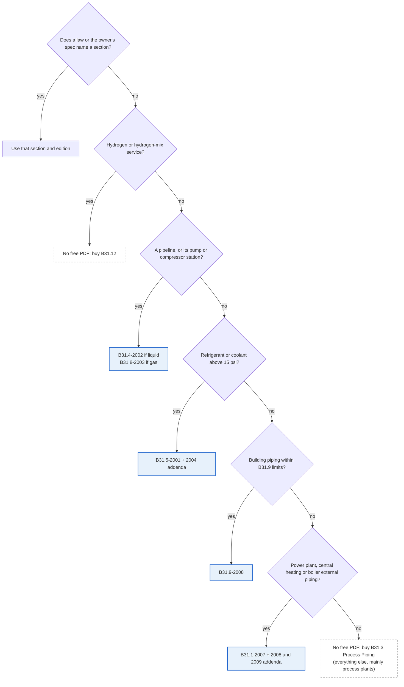

# Choosing which PDF to open

The Introduction of B31.1-2007 makes the owner responsible for choosing the Code section that most nearly applies, and allows different sections for different parts of one installation. First check whether a regulator or the owner's specification already names a section and an edition, because that overrides everything below.

## Decision flow

Ask the questions top to bottom and stop at the first yes. Solid boxes are free PDFs listed in the [PDF library](sections.md); dashed boxes have no free PDF.

??? info "The same flow as a list (easier on a phone or with a screen reader)"
    Stop at the first question you answer yes to.

    1. **Does a law or the owner's specification name a section?** Use that section and edition.
    2. **Hydrogen or hydrogen-mix service?** No free PDF: buy B31.12.
    3. **A pipeline, or its pump or compressor station?** [B31.4-2002](https://law.resource.org/pub/us/cfr/ibr/002/asme.b31.4.2002.pdf) if liquid, [B31.8-2003](https://law.resource.org/pub/us/cfr/ibr/002/asme.b31.8.2003.pdf) if gas.
    4. **Refrigerant or coolant above 15 psi?** [B31.5-2001](https://archive.org/details/gov.law.asme.b31.5.2001) with its 2004 addenda.
    5. **Building piping within B31.9 limits?** [B31.9-2008](https://archive.org/details/gov.law.asme.b31.9.2008).
    6. **Power plant, central heating or boiler external piping?** [B31.1-2007](https://archive.org/details/gov.law.asme.b31.1.2007) with its 2008 and 2009 addenda.
    7. **None of the above** (mainly process plants): no free PDF, buy B31.3 Process Piping.

A system that crosses a boundary, such as a pipeline entering a plant, gets a section on each side of the break point named in the design basis.

## Where scopes meet

At each boundary, open the PDF named for each side. Limits for B31.9 are quoted from B31.9-2008, para. 900.1.2.

| Boundary | Open this PDF when | Open the other when |
| --- | --- | --- |
| Buildings vs power | **B31.9-2008** for building piping within its limits: steam and condensate to 150 psig and 366°F, liquids to 350 psig and 250°F, compressed air and gas to 150 psig, minimum 0°F; carbon steel to NPS 48 and 0.50 in. wall, stainless to NPS 24 | **B31.1-2007** above any of those limits, or for a central plant serving several buildings. Boiler external piping follows the boundaries drawn in Fig. 900.1.2 of B31.9 and in B31.1 |
| Liquid vs gas pipelines | **B31.4-2002** for predominantly liquid products, including CO₂ and anhydrous ammonia | **B31.8-2003** for predominantly gas, including gathering lines and compressor stations |
| Pipeline vs plant | **B31.4-2002** or **B31.8-2003** for the line, its pump, compressor, regulating and metering stations, and terminals | Inside a refinery or process plant the scope belongs to B31.3, which has no free PDF |
| Refrigeration vs buildings | **B31.5-2001** for refrigerant and secondary coolant piping | **B31.9-2008** for chilled water and other water loops in a building |
| Gas pipeline integrity | **B31.8-2003** for design and construction | **B31.8S-2004** for the integrity management program, and **B31G-1991** to assess corroded pipe |

Fuel gas piping downstream of the meter is outside every PDF here; the B31.1-2007 Introduction points it to ANSI Z223.1 (NFPA 54), the National Fuel Gas Code.
