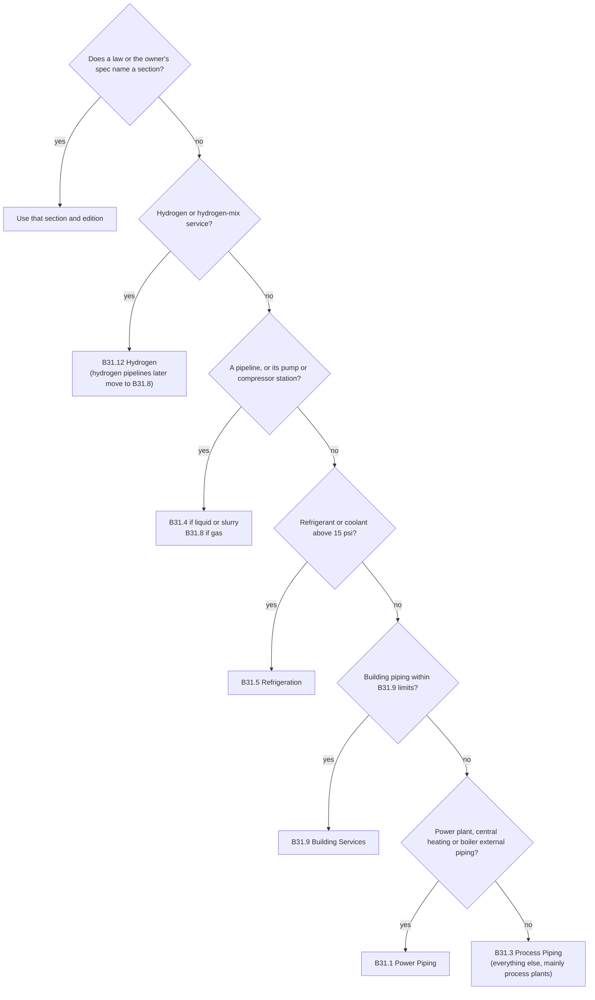

# Choosing the right B31 section

Pick a section by what the piping carries and where it sits (a plant, a building, or a cross-country pipeline), not by pressure alone. First check whether a regulator or the owner's specification already names a section and an edition, because that overrides any rule of thumb.

This guide is a starting point drawn from each section's published scope and common practice. Confirm the result against the scope chapter (para. 100.1, 300, 400.1 and so on) of the edition you use.

## Decision flow

Ask the questions top to bottom and stop at the first yes.

A system that crosses a boundary, such as a pipeline entering a plant, gets a section on each side of the break point named in the design basis.

## Where the sections meet

Most hard cases sit at a property line or a facility type, and the Code makes the owner responsible for choosing the section where two could apply. Pressure and size limits marked "approx." are from memory, not from ASME's pages; check them in the edition you use.

| Boundary | Use the first when | Use the second when | Grey areas |
| --- | --- | --- | --- |
| B31.1 vs B31.3 | The facility makes power or central steam (power station, district heating plant, institutional boiler house) | The facility processes fluids (refinery, chemical, pharma, gas plant), including its own utility steam and water | Boiler external piping must follow B31.1 with BPVC Section I wherever the boiler sits. Cogeneration inside a process plant is often split by system, as the owner decides |
| B31.4 vs B31.8 | The pipeline carries a liquid or slurry (crude, products, NGL, LPG, CO₂, ammonia) | The pipeline carries gas, including gathering lines, compressor stations and distribution | CO₂ and NGL are B31.4; gas with condensate is usually B31.8. US regulation (49 CFR 195 for liquids, 192 for gas) settles most cases |
| Pipeline (B31.4 or B31.8) vs B31.3 | Piping is on the pipeline right-of-way, or in its pump, compressor, metering or regulating station | Piping is inside a refinery, process plant or gas processing plant | The break is usually the plant's isolation valve or property line, as set in the project basis |
| B31.9 vs B31.1 | Building heating, cooling and utility piping that stays within B31.9's limits (approx. steam to 150 psig, liquids to 350 psig and 250°F; size and wall limits by material) | Above those limits, or a central plant serving several buildings | Boiler external piping above low-pressure boiler limits goes to B31.1 even in a building |
| B31.5 vs B31.9 or B31.3 | The fluid is a refrigerant or secondary coolant above 15 psi | Chilled water and other water loops (B31.9 in buildings), or refrigeration that is part of a process (often B31.3) | Ammonia plants often use B31.5 for the refrigeration system and B31.3 for process ammonia |
| B31.12 vs B31.3 or B31.8 | Any piping or pipeline in hydrogen service, unless a regulator or owner names another section | Hydrogen blended at low percentages into natural gas networks may stay under B31.8 with operator guidance | The new B31.8 hydrogen chapter, when published, will move hydrogen pipelines to B31.8 |

Two checks override everything above: a law or regulator that names a section (for example US pipeline rules, state boiler laws, or Canadian provincial adoption through CSA B51), and the owner's design basis or contract.
